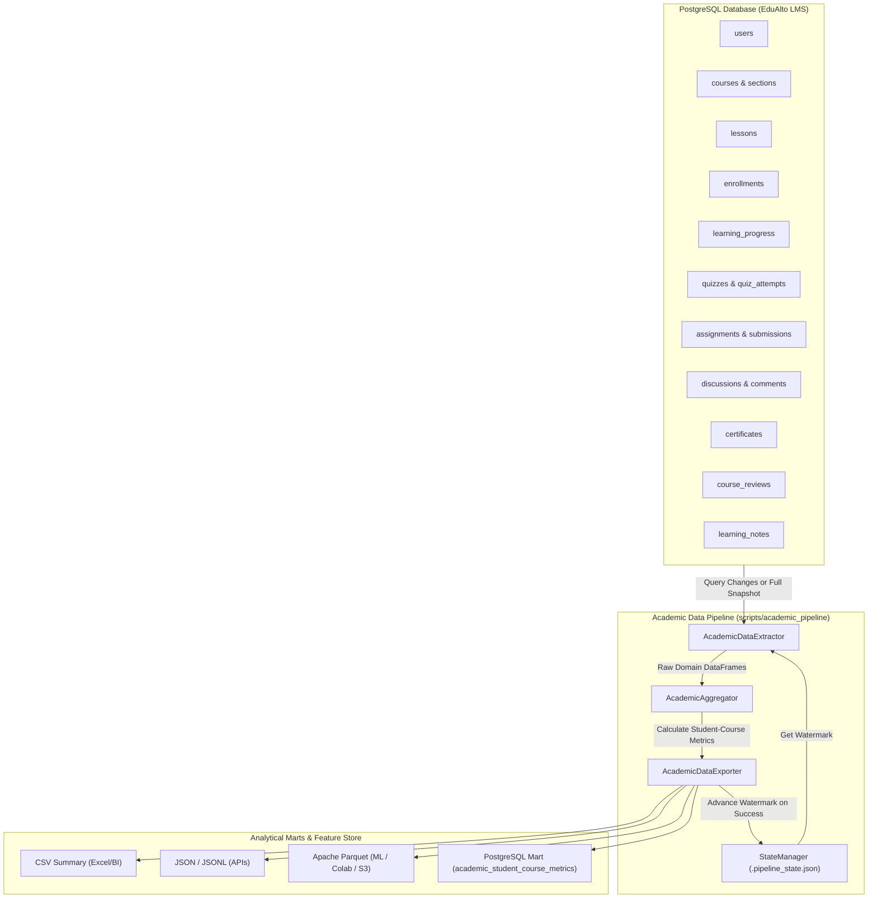

# Kiến trúc Quy trình Trích xuất Dữ liệu Học thuật (Academic Data Pipeline Architecture)

- **Mã nhiệm vụ:** Xây dựng quy trình trích xuất dữ liệu học thuật (Tiếp nối báo cáo khảo sát nguồn dữ liệu `EDU-96`)
- **Ngôn ngữ triển khai:** Python 3.13 (hỗ trợ môi trường phân tích dữ liệu, ML / Colab, và batch ETL)
- **Cơ sở dữ liệu nguồn:** PostgreSQL 16 (EduAlto database)
- **Định dạng dữ liệu đầu ra:** CSV, JSON, JSONL, Apache Parquet, PostgreSQL Analytical Mart Table
- **Mã nguồn:** `scripts/academic_pipeline/`
- **Tập lệnh khởi chạy:** `scripts/run_academic_pipeline.py`

---

## 1. Mục tiêu và Phạm vi

Quy trình trích xuất dữ liệu học thuật được thiết kế nhằm giải quyết 4 yêu cầu nghiệp vụ then chốt:

1. **Xây dựng Python pipeline hoàn chỉnh**: Kiến trúc module phân tầng rõ ràng (Config, DB, State, Extractor, Aggregator, Exporter, Pipeline, CLI), chịu tải tốt, xử lý lỗi an toàn và có kiểm thử tự động 100%.
2. **Trích xuất dữ liệu từ PostgreSQL**: Truy vấn dữ liệu học tập đa chiều với chế độ giao dịch chỉ đọc (`READ ONLY`) và `statement_timeout` 60 giây, bảo đảm an toàn tuyệt đối cho cơ sở dữ liệu vận hành.
3. **Tổng hợp dữ liệu theo Sinh viên và Môn học (Student-Course Profiling)**: Tính toán tập chỉ số học thuật đa chiều làm Feature Store cho các mô hình AI/ML (Hệ thống gợi ý khóa học / Ranker XGBoost, Dự báo nguy cơ học viên bỏ dở / Early-Warning System, Chẩn đoán kiến thức).
4. **Hỗ trợ trích xuất gia tăng (Incremental Extraction)**: Sử dụng checkpoint watermark timestamp (`.pipeline_state.json`) để chỉ trích xuất những bản ghi có biến động kể từ lần chạy trước, hợp nhất (merge/upsert) vào tập dữ liệu tổng thể và hoàn tất trong thời gian tối thiểu.

---

## 2. Kiến trúc Tổng thể Pipeline

---

## 3. Danh mục Chỉ số Tổng hợp theo Sinh viên và Môn học

Khóa chính xác định bản ghi: `(student_id, course_id)`.

| Nhóm chỉ số | Tên trường | Kiểu dữ liệu | Ý nghĩa học thuật |
| :--- | :--- | :--- | :--- |
| **Định danh** | `student_id`, `student_name`, `student_email` | String | Thông tin học viên |
| | `course_id`, `course_title`, `course_slug`, `course_level` | String | Thông tin môn học / khóa học |
| | `enrollment_status`, `enrolled_at` | String / Datetime | Trạng thái và thời điểm ghi danh |
| **Giáo trình** | `total_lessons`, `total_duration_seconds` | Integer | Số lượng bài học & tổng thời lượng môn học |
| | `total_quizzes`, `total_assignments` | Integer | Tổng số bài quiz & bài tập trong khóa |
| **Tiến độ học** | `completed_lessons_count` | Integer | Số bài học học viên đã hoàn thành |
| | `lesson_completion_rate_pct` | Numeric (%) | Tỷ lệ hoàn thành bài giảng (0 - 100%) |
| | `completed_duration_seconds` | Integer | Tổng thời lượng các bài đã học |
| | `duration_completion_rate_pct` | Numeric (%) | Tỷ lệ thời lượng học (0 - 100%) |
| | `first_lesson_completed_at`, `last_lesson_completed_at` | Datetime | Mốc hoàn thành bài học đầu & cuối |
| **Trắc nghiệm** | `quizzes_attempted_count`, `quizzes_passed_count` | Integer | Số quiz đã làm & số quiz đạt chuẩn |
| | `total_quiz_attempts` | Integer | Tổng số lượt nộp bài trắc nghiệm |
| | `avg_quiz_score`, `max_quiz_score` | Numeric | Điểm trắc nghiệm trung bình và cao nhất (thang 100) |
| | `quiz_accuracy_pct` | Numeric (%) | Tỷ lệ số câu trả lời đúng trên tổng số câu đã làm |
| | `quiz_coverage_pct` | Numeric (%) | Tỷ lệ bao phủ bài quiz trong môn học |
| **Bài tập** | `assignments_submitted_count`, `assignments_graded_count` | Integer | Số bài tập đã nộp & số bài đã chấm điểm |
| | `avg_assignment_score_pct` | Numeric (%) | Điểm bài tập tự luận trung bình quy đổi % |
| | `submissions_on_time_count`, `submissions_late_count` | Integer | Số bài nộp đúng hạn và số bài nộp quá hạn |
| | `on_time_submission_rate_pct` | Numeric (%) | Tỷ lệ nộp bài đúng hạn (%) |
| **Tương tác** | `discussions_count`, `discussion_comments_count` | Integer | Số câu hỏi thắc mắc & số bình luận đóng góp |
| | `video_timestamp_questions_count` | Integer | Số câu hỏi gắn mốc thời gian video cụ thể |
| | `learning_notes_count` | Integer | Số ghi chú cá nhân học viên đã lưu |
| | `has_reviewed_course`, `review_rating` | Boolean, Float | Trạng thái đánh giá khóa học & số sao (1-5) |
| **Văn bằng** | `is_course_completed` | Boolean | Hoàn thành 100% giáo trình hoặc có chứng chỉ |
| | `has_certificate`, `certificate_number`, `certificate_issued_at` | Boolean, String | Thông tin chứng chỉ điện tử chính thức |
| **Chuyên cần & Nguy cơ** | `first_activity_at`, `last_activity_at` | Datetime | Mốc hoạt động đầu tiên & gần nhất |
| | `days_since_last_activity` | Integer | Số ngày trôi qua kể từ hoạt động gần nhất |
| | `is_inactive` | Boolean | Cờ không hoạt động (> 14 ngày chưa hoạt động & chưa xong khóa) |
| | `academic_engagement_score` | Numeric (0-100) | Điểm gắn kết tổng hợp: 40% Tiến độ + 25% Quiz + 20% Bài tập + 15% Tương tác |
| | `academic_status` | String | Phân loại: `COMPLETED`, `EXCELLING`, `ON_TRACK`, `AT_RISK`, `JUST_STARTED` |

---

## 4. Cơ chế Trích xuất Gia tăng (Incremental Extraction Mechanics)

1. **Khởi tạo và Đọc Watermark**:
   - Pipeline truy xuất mốc thời gian `last_watermark` từ file `.pipeline_state.json`.
   - Nếu chưa từng chạy hoặc chạy với cờ `--mode full` (hoặc `--reset-state`): Pipeline thực hiện trích xuất toàn bộ (Full snapshot).
2. **Nhận diện Cặp Thay đổi (Changed Pair Detection)**:
   - Pipeline phát lệnh truy vấn nhanh trên các bảng hoạt động:
     - `enrollments`: `updated_at > watermark OR enrolled_at > watermark`
     - `learning_progress`: `updated_at > watermark OR completed_at > watermark`
     - `quiz_attempts`: `submitted_at > watermark`
     - `assignment_submissions`: `updated_at > watermark OR submitted_at > watermark`
     - `discussions`: `updated_at > watermark OR created_at > watermark`
     - `discussion_comments`: `updated_at > watermark OR created_at > watermark`
     - `certificates`: `created_at > watermark OR issued_at > watermark`
     - `course_reviews`: `updated_at > watermark OR created_at > watermark`
     - `learning_notes`: `updated_at > watermark OR created_at > watermark`
   - Tập hợp các cặp `(student_id, course_id)` qua phép toán Union.
3. **Trường hợp Không có dữ liệu mới (`UP_TO_DATE`)**:
   - Nếu tập hợp rỗng: Pipeline dừng ngay lập tức trong vài chục mili-giây, thông báo dữ liệu đã đồng bộ mới nhất.
4. **Trường hợp Có dữ liệu thay đổi**:
   - Pipeline chỉ trích xuất dữ liệu chi tiết cho các cặp sinh viên - môn học bị ảnh hưởng.
   - Tính toán lại toàn bộ chỉ số học thuật cho tập bản ghi này.
   - Nạp tập dữ liệu tổng thể lịch sử từ đĩa, thực hiện **hợp nhất nguyên tử (Vectorized Merge)**:
     - Ghi đè (Overwrite) các bản ghi cũ của cùng cặp `(student_id, course_id)`.
     - Bổ sung (Append) các cặp sinh viên - môn học mới ghi danh.
     - Giữ nguyên toàn bộ các cặp sinh viên - môn học không có thay đổi.
   - Xuất dữ liệu mới ra các tệp đích và lưu watermark mới vào checkpoint.

---

## 5. Kết quả Kiểm thử Tự động (Unit & Integration Tests)

Toàn bộ logic của pipeline được bao phủ bởi 6 ca kiểm thử chuyên sâu:
- `test_database_config_defaults`: Kiểm thử cấu hình kết nối PostgreSQL.
- `test_database_config_from_spring_url`: Kiểm thử phân tích cấu hình từ Spring Boot JDBC URL.
- `test_state_manager_lifecycle`: Kiểm thử lưu trữ an toàn nguyên tử, khôi phục và reset watermark.
- `test_aggregate_complete_student_telemetry`: Kiểm thử tính toán đầy đủ các chỉ số học thuật, điểm gắn kết tổng hợp và trạng thái hoàn thành khóa học.
- `test_merge_incremental`: Kiểm thử tính năng ghi đè bản ghi cũ và bổ sung bản ghi mới trong trích xuất gia tăng.
- `test_full_and_incremental_pipeline_e2e`: Kiểm thử toàn vẹn vòng đời tích hợp: Chạy Full -> Kiểm tra định dạng xuất (CSV, JSON, Parquet) -> Chạy Incremental không thay đổi -> Thêm tiến độ mới & cấp chứng chỉ -> Chạy Incremental phát hiện và cập nhật dữ liệu chính xác.

**Trạng thái kiểm thử:** `6 passed in 0.60s (100% Đạt)`.
