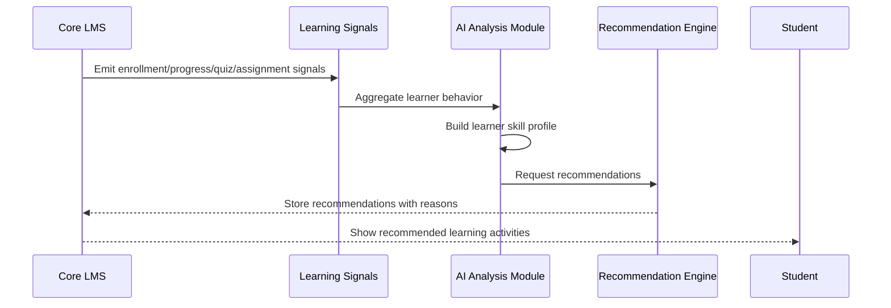

# AI Extension Architecture

AI trong EduAlto là extension của LMS, không phải dependency bắt buộc của core LMS.

## Goals

- Phân tích kỹ năng học viên.
- Gợi ý khóa học, bài học, tài liệu hoặc hoạt động học tiếp theo.
- Giải thích lý do gợi ý bằng dữ liệu minh bạch.
- Lưu version model và metadata để audit.

## Authoring import and grounded assistant

The first implemented AI features remain inside the `ai` module of the modular monolith:

- An instructor uploads a legacy Word DOC, DOCX or text PDF and supplies education level, subject, grade and optional curriculum context. A bounded worker extracts source text and asks Gemini for a validated curriculum draft. A persisted job exposes progress over REST polling. Applying a reviewed draft appends chapters and TEXT lessons through `CourseStructureService` in one transaction; lessons remain DRAFT. The apply operation is idempotent.
- Alto Bot retrieves relevant course metadata and lesson text using PostgreSQL full-text search before generation. Visitors only receive curated public platform information. Authenticated users can retrieve public course descriptions; lesson bodies require active enrollment, a published preview lesson, or course ownership. Source links are constructed on the server and returned with the answer. Draft imports only become retrievable after the instructor applies them, and only their owner can retrieve unpublished lesson bodies.
- Gemini is called over HTTPS from the backend. `AI_ENABLED=false` or a missing API key disables provider calls without affecting core LMS functions. One concurrent provider call, configurable request budgets, bounded input/output and timeouts constrain Free Tier usage. No local LLM or GPU is required.
- File and retrieved text are untrusted data. Prompts prohibit following embedded instructions; generated content is validated and encoded before persistence. JSON Schema controls format, not factual or legal correctness.
- The curated education reference catalog records a verification date and official sources. A deterministic selector maps level/subject/grade/school year to curriculum, assessment and lesson-plan guidance before generation. Textbook names remain optional extraction hints and do not affect the selected rules. The catalog retains textbook policy facts for explicit chatbot questions. It handles the2025 subject-specific amendment and separates university/vocational programs from general education. Institution-specific curricula and regulation completeness still require review. Mapping supplies references, not a compliance certificate; future catalog updates must check effective dates and superseded documents.

The API key belongs only in backend environment variables or GitHub Actions secrets. Free Tier documents/prompts may be used by Google to improve products. Subscription plans for Gemini Apps are separate from API project billing.

See [AI setup and API contract](../deployment/gemini-ai.md) for environment names, quotas, operational limits and activation.

## Non-goals in foundation

- Không implement AI model.
- Không tự host hoặc huấn luyện model. Provider calls are opt-in through the AI configuration.
- Không hard-code AI logic trong CourseService hoặc LearningProgressService.

## Data flow

## Boundaries

Core modules emit learning signals. AI module consumes signals asynchronously or through scheduled jobs. Course, lesson and learning services must not depend on AI services directly.

## AI-related tables

- `skills`
- `skill_categories`
- `learner_skills`
- `skill_assessments`
- `learning_signals`
- `recommendations`
- `recommendation_items`
- `recommendation_reasons`
- `ai_model_versions`

## Failure behavior

If AI module is unavailable:

- Course browsing works.
- Lesson learning works.
- Quiz/assignment works.
- Recommendations are hidden or show empty state: `Chưa có gợi ý học tập phù hợp`.

## Privacy and safety

- Store only learning data needed for recommendation quality.
- Keep model input/output metadata auditable.
- Do not expose raw model prompts or sensitive learner data in frontend.
- Add opt-out policy before production if AI becomes user-facing.
