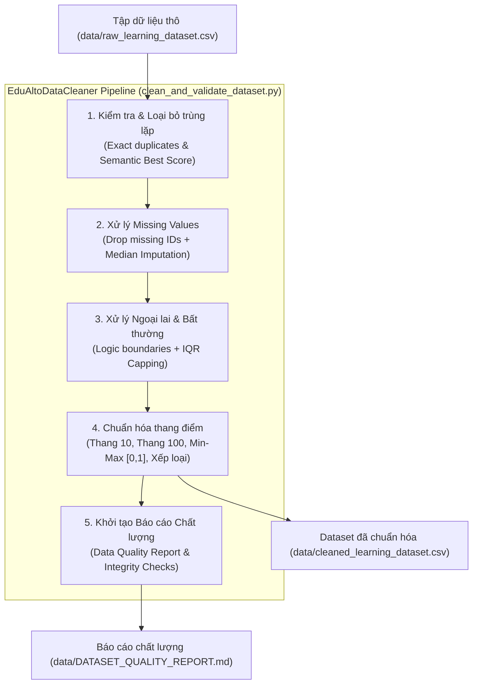

# Quy trình Làm sạch và Xác thực Dữ liệu Học thuật (Data Cleaning & Validation Pipeline)

- **Mã nhiệm vụ (Jira Ticket):** `EDU-100` (Epic: `EDU-101` - Phân hệ Phân tích dữ liệu & Trí tuệ nhân tạo)
- **Tiêu đề:** Thực hiện làm sạch và xác thực dữ liệu.
- **Ngôn ngữ triển khai:** Python 3.13 (`pandas`, `numpy`, `scipy`, `pytest`)
- **Tập tin thực thi chính:** [`scripts/data_pipeline/clean_and_validate_dataset.py`](file:///c:/edu-alto/scripts/data_pipeline/clean_and_validate_dataset.py)
- **Tập lệnh sinh dữ liệu mẫu:** [`scripts/data_pipeline/generate_raw_dataset.py`](file:///c:/edu-alto/scripts/data_pipeline/generate_raw_dataset.py)
- **Bộ kiểm thử tự động:** [`scripts/data_pipeline/test_data_pipeline.py`](file:///c:/edu-alto/scripts/data_pipeline/test_data_pipeline.py)
- **Báo cáo kết quả tự động:** [`data/DATASET_QUALITY_REPORT.md`](file:///c:/edu-alto/data/DATASET_QUALITY_REPORT.md)

---

## 1. Mục tiêu và Phạm vi Nhiệm vụ EDU-100

Trong hệ sinh thái EduAlto LMS, dữ liệu học tập thu thập từ học viên (điểm kiểm tra Quiz, bài tập Assignment, thời lượng xem video, tần suất học tập) thường chứa các sai số do lỗi đường truyền, hành vi nộp bài nhiều lần, lỗi nhập liệu hoặc sự khác biệt về thang điểm giữa các giảng viên.

Nhiệm vụ **EDU-100** xây dựng quy trình chuẩn hóa và làm sạch dữ liệu tự động, giải quyết triệt để 5 yêu cầu nghiệp vụ:
1. **Xử lý missing values**: Thống kê, loại bỏ các bản ghi khuyết thiếu định danh bắt buộc (`student_id`), áp dụng kỹ thuật điền dữ liệu thông minh (*Intelligent Imputation*) theo trung vị nhóm cho các cột số.
2. **Kiểm tra dữ liệu bất thường (Anomalies & Outliers)**: Phát hiện và chặn trần/chặn sàn theo biên logic học thuật ($0 \le \text{điểm} \le \text{max\_score}$, thời lượng học $> 0$, tiến độ hoàn thành $\le \text{tổng bài}$) và loại trừ ngoại lai thống kê bằng phương pháp khoảng tứ phân vị (IQR).
3. **Chuẩn hóa thang điểm (Score Normalization)**: Đồng bộ tất cả các loại hình đánh giá (Quiz thang 100, Assignment thang 10, Midterm thang 50, Final Project thang 100) về **Thang điểm 10 chuẩn học thuật Việt Nam** $[0.0, 10.0]$, **Thang điểm chuẩn hóa Min-Max** $[0.0, 1.0]$ cho Machine Learning, và tự động xếp loại học lực (*Xuất sắc, Giỏi, Khá, Trung bình, Yếu*).
4. **Kiểm tra dữ liệu trùng lặp (Duplicate Detection)**: Loại bỏ trùng lặp hoàn toàn (*Exact Duplicates* do click đúp) và xử lý trùng lặp nộp bài nhiều lần (*Semantic Duplicates*) theo chính sách **Best Score Policy** (giữ kết quả cao nhất của học viên).
5. **Tạo báo cáo chất lượng dataset**: Tự động sinh báo cáo kiểm toán chất lượng (*Data Quality & Profiling Report*) chi tiết về kích thước mẫu trước/sau, tỷ lệ làm sạch, phân phối thống kê và bảng kiểm định toàn vẹn dữ liệu.

---

## 2. Kiến trúc Module Pipeline



---

## 3. Đặc tả 5 Công đoạn Xử lý Kỹ thuật

### 3.1. Nhiệm vụ 4: Kiểm tra và Loại bỏ Trùng lặp
- **Trùng lặp dòng hoàn toàn (Exact Duplicates):** Phát hiện qua tập thuộc tính nội dung `(student_id, course_id, assessment_id, raw_score, submitted_at)`. Các dòng trùng lặp phát sinh do lỗi gửi kép HTTP request sẽ bị loại bỏ ngay lập tức.
- **Trùng lặp nộp bài nhiều lần (Semantic Duplicates):** Nhóm theo bộ khóa `(student_id, course_id, assessment_id)`. Áp dụng thuật toán sắp xếp giảm dần theo `raw_score` và giữ lại bản ghi có điểm số cao nhất (`keep='first'`), bảo vệ quyền lợi thành tích học tập của học viên.

### 3.2. Nhiệm vụ 1: Xử lý Giá trị Khuyết thiếu (Missing Values)
- **Quy tắc loại bỏ (Drop Policy):** Các dòng bị thiếu `student_id` (trị giá `null`, `NaN` hoặc chuỗi rỗng) lập tức bị loại bỏ do vi phạm tính toàn vẹn định danh học thuật.
- **Quy tắc điền dữ liệu (Imputation Policy):**
  - Cột `raw_score`: Điền bằng giá trị trung vị (*Median*) của cùng loại bài đánh giá trong cùng khóa học. Gắn cờ `score_was_imputed = True` để phục vụ truy vết kiểm toán.
  - Cột `time_spent_minutes`: Điền theo trung vị thời lượng của loại bài đánh giá tương ứng.
  - Cột `study_frequency_per_week`: Điền theo trung vị toàn hệ thống.
  - Cột `completed_lessons_count`: Điền theo trung vị tiến độ của khóa học tương ứng.

### 3.3. Nhiệm vụ 2: Kiểm tra Dữ liệu Bất thường (Anomalies & Outliers)
- **Hiệu chỉnh biên logic:**
  - $\text{raw\_score} < 0 \implies \text{raw\_score} = 0.0$
  - $\text{raw\_score} > \text{max\_score} \implies \text{raw\_score} = \text{max\_score}$
  - $\text{time\_spent\_minutes} \le 0 \implies \text{time\_spent\_minutes} = \text{median\_time}$
  - $\text{completed\_lessons} > \text{total\_lessons} \implies \text{completed\_lessons} = \text{total\_lessons}$
- **Xử lý ngoại lai thời lượng (Session Hanging Timeout):**
  - Xác định ngưỡng trần theo khoảng tứ phân vị: $\text{Upper Bound} = \min(Q_3 + 3.0 \times \text{IQR}, 720.0 \text{ phút})$.
  - Cắt trần (Winsorization/Capping) tại ngưỡng này để tránh làm lệch các phép tính thời lượng trung bình.

### 3.4. Nhiệm vụ 3: Chuẩn hóa Thang điểm (Score Normalization)
- **Thang điểm 10 học thuật Việt Nam:**
  $$\text{score\_scale\_10} = \operatorname{round}\left(\frac{\text{raw\_score}}{\text{max\_score}} \times 10.0, 2\right)$$
- **Thang điểm 100:**
  $$\text{score\_scale\_100} = \operatorname{round}\left(\frac{\text{raw\_score}}{\text{max\_score}} \times 100.0, 2\right)$$
- **Thang chuẩn hóa Min-Max $[0.0, 1.0]$ cho AI/ML:**
  $$\text{score\_normalized\_0\_1} = \operatorname{round}\left(\frac{\text{raw\_score}}{\text{max\_score}}, 4\right)$$
- **Quy tắc phân loại học lực (Academic Ranking):**
  - $\text{score\_scale\_10} \ge 9.0 \implies \text{Xuất sắc}$
  - $8.0 \le \text{score\_scale\_10} < 9.0 \implies \text{Giỏi}$
  - $6.5 \le \text{score\_scale\_10} < 8.0 \implies \text{Khá}$
  - $5.0 \le \text{score\_scale\_10} < 6.5 \implies \text{Trung bình}$
  - $\text{score\_scale\_10} < 5.0 \implies \text{Yếu}$

### 3.5. Nhiệm vụ 5: Tạo Báo cáo Chất lượng Dataset
- Khởi tạo file Markdown độc lập tại [`data/DATASET_QUALITY_REPORT.md`](file:///c:/edu-alto/data/DATASET_QUALITY_REPORT.md).
- Trình bày bảng so sánh trước và sau khi làm sạch (*Before vs. After*).
- Thống kê tỷ lệ đỗ (*Pass rate*), phân vị $Q_1, Q_2, Q_3$, độ lệch chuẩn và phân phối xếp loại.
- Bảng tự động kiểm định 5 tiêu chuẩn toàn vẹn (*Completeness, Validity, Uniqueness, Consistency, AI Readiness*).

---

## 4. Hướng dẫn Khởi chạy và Kiểm thử

### 4.1. Khởi chạy toàn bộ Pipeline
```bash
# 1. Sinh dữ liệu thô mẫu (nếu cần thử nghiệm)
python scripts/data_pipeline/generate_raw_dataset.py

# 2. Chạy pipeline làm sạch, chuẩn hóa và xuất báo cáo
python scripts/data_pipeline/clean_and_validate_dataset.py
```

### 4.2. Chạy bộ kiểm thử tự động (Unit Tests)
```bash
python -m pytest scripts/data_pipeline/test_data_pipeline.py -v
```

**Kết quả kiểm thử đạt 100%:**
```text
scripts/data_pipeline/test_data_pipeline.py::test_remove_duplicates PASSED
scripts/data_pipeline/test_data_pipeline.py::test_handle_missing_values PASSED
scripts/data_pipeline/test_data_pipeline.py::test_detect_and_handle_anomalies PASSED
scripts/data_pipeline/test_data_pipeline.py::test_normalize_scores PASSED
scripts/data_pipeline/test_data_pipeline.py::test_full_pipeline_end_to_end PASSED
============================== 5 passed in 0.67s ==============================
```
