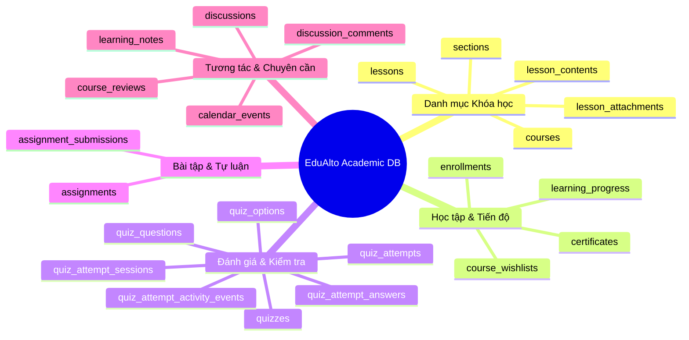
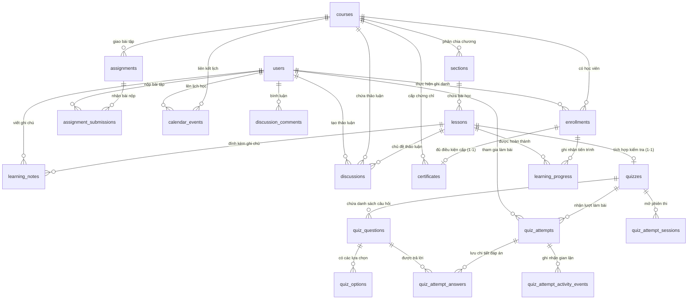

# Báo cáo Phân tích các Nguồn Dữ liệu Học thuật Hiện có (EDU-96)

- **Mã công việc:** EDU-96 (thuộc Epic EDU-101)
- **Tác vụ:** Phân tích các nguồn dữ liệu học thuật hiện có phục vụ Machine Learning & AI
- **Đối tượng khảo sát:** Hệ thống cơ sở dữ liệu PostgreSQL của nền tảng EduAlto (cập nhật từ Flyway V1 đến V35)
- **Trạng thái:** Hoàn thành khảo sát & đồng bộ trạng thái triển khai (EDU-97 / EDU-98 / EDU-99 / EDU-100)

---

## 1. Khảo sát Cơ sở Dữ liệu EduAlto Hiện tại

EduAlto áp dụng kiến trúc **Modular Monolith** với hệ quản trị cơ sở dữ liệu **PostgreSQL 16**. Toàn bộ schema được phiên bản hóa và quản lý chặt chẽ qua Flyway migration (`V1` đến `V35`), sử dụng khóa chính dạng UUID, chuẩn đặt tên `snake_case`, cùng các ràng buộc toàn vẹn khóa ngoại (FK) và chỉ mục (Index) hiệu năng cao. Từ bản cập nhật `V34` và `V35`, bảng sự kiện chuẩn hóa `learning_activities` đã được bổ sung cùng các hook thu thập thời gian thực.

### Tổng quan các miền dữ liệu học thuật

---

## 2. Xác định Chi tiết các Nguồn Dữ liệu Học thuật

### 2.1. Nguồn dữ liệu Ghi danh (`enrollment`)
- **Bảng đại diện:** `enrollments` (Flyway `V7__enrollment_and_learning_progress.sql`).
- **Các trường dữ liệu cốt lõi:**
  - `id`: UUID (Primary Key).
  - `student_id`: UUID (Khóa ngoại trỏ về `users.id`).
  - `course_id`: UUID (Khóa ngoại trỏ về `courses.id`).
  - `status`: `VARCHAR(40)` (Ràng buộc `chk_enrollments_status check (status = 'ACTIVE')`).
  - `enrolled_at`: `TIMESTAMPTZ` (Thời điểm học viên ghi danh thành công).
  - `created_at`, `updated_at`: `TIMESTAMPTZ`.
- **Ràng buộc toàn vẹn:** `uk_enrollments_student_course (student_id, course_id)` bảo đảm mỗi học viên chỉ có một bản ghi ghi danh duy nhất cho một khóa học.
- **Ý nghĩa với học thuật & ML:** Đánh dấu mốc thời gian bắt đầu học tập (T0), xác định kích thước nhóm học viên (cohort), tính toán độ trễ từ lúc đăng ký tài khoản đến khi tham gia khóa học.

### 2.2. Nguồn dữ liệu Tiến độ Khóa học (`course progress`)
- **Bảng đại diện:** `learning_progress` (Flyway `V7`) và `certificates` (Flyway `V17`).
- **Các trường dữ liệu cốt lõi:**
  - `learning_progress.id`: UUID.
  - `learning_progress.enrollment_id`: UUID (FK trỏ về `enrollments.id`).
  - `learning_progress.course_id`, `section_id`, `lesson_id`: UUID (Phân cấp bài học cụ thể).
  - `learning_progress.completed_at`: `TIMESTAMPTZ` (Thời điểm học viên hoàn thành bài học).
  - `certificates.issued_at`: `TIMESTAMPTZ` (Thời điểm cấp chứng chỉ khi hoàn thành 100% chương trình và vượt qua bài quiz bắt buộc).
- **Ý nghĩa với học thuật & ML:**
  - Tỷ lệ hoàn thành khóa học: $\text{CompletionRate} = \frac{\text{Count}(\text{completed\_lessons})}{\text{TotalLessons}} \times 100\%$.
  - Tốc độ học (Learning Velocity): Số bài học hoàn thành trung bình mỗi ngày/tuần.
  - Nhận diện điểm nghẽn (Drop-off Bottlenecks): Bài học nào học viên dừng lại nhiều nhất và không tiếp tục học.

### 2.3. Nguồn dữ liệu Đánh giá Trắc nghiệm (`quizzes`)
- **Bảng đại diện:**
  - Cấu trúc: `quizzes`, `quiz_questions`, `quiz_options` (Flyway `V16`, `V29`).
  - Lịch sử làm bài: `quiz_attempts`, `quiz_attempt_answers` (Flyway `V16`).
  - Phiên làm bài & Giám sát: `quiz_attempt_sessions`, `quiz_attempt_activity_events` (Flyway `V29`).
- **Các trường dữ liệu cốt lõi:**
  - `quizzes.passing_score`: `NUMERIC(5,2)` (Điểm chuẩn qua bài, 0 - 100).
  - `quizzes.duration_minutes`: `INTEGER` (Thời lượng giới hạn làm bài).
  - `quiz_attempts.score`: `NUMERIC(5,2)` (Điểm đạt được).
  - `quiz_attempts.correct_answers` / `total_questions`: `INTEGER`.
  - `quiz_attempts.passed`: `BOOLEAN`.
  - `quiz_attempt_answers.is_correct`: `BOOLEAN` (Đúng/sai từng câu hỏi).
  - `quiz_attempt_sessions.started_at`, `expires_at`, `status`: `IN_PROGRESS`, `SUBMITTED`, `EXPIRED`.
  - `quiz_attempt_activity_events.event_type`: `TAB_HIDDEN`, `WINDOW_BLUR`, `COPY`, `PASTE` cùng timestamp `occurred_at`.
- **Ý nghĩa với học thuật & ML:** Cung cấp dữ liệu chi tiết ở cấp độ vi mô (Item-level response) phục vụ mô hình hóa năng lực học viên, độ khó của câu hỏi, và đo lường mức độ tập trung/tính trung thực khi làm bài.

### 2.4. Nguồn dữ liệu Bài tập Tự luận (`assignments`)
- **Bảng đại diện:** `assignments`, `assignment_submissions` (Flyway `V8__course_assignments.sql`).
- **Các trường dữ liệu cốt lõi:**
  - `assignments.due_at`: `TIMESTAMPTZ` (Hạn chót nộp bài).
  - `assignments.max_score`: `NUMERIC(8,2)` (Thang điểm tối đa).
  - `assignment_submissions.response_text`: `TEXT` (Bài làm tự luận của học viên).
  - `assignment_submissions.submitted_at`: `TIMESTAMPTZ` (Thời điểm nộp).
  - `assignment_submissions.score`: `NUMERIC(8,2)` (Điểm số do giảng viên chấm).
  - `assignment_submissions.feedback`: `TEXT` (Nhận xét định tính của giảng viên).
  - `assignment_submissions.graded_at`: `TIMESTAMPTZ`.
- **Ý nghĩa với học thuật & ML:** Cung cấp tập dữ liệu văn bản (NLP) cho bài toán tự động chấm điểm bài luận (Automated Essay Scoring), phân tích ngữ nghĩa nhận xét của giảng viên, và tính toán tính kỷ luật (thời gian nộp trước/sau `due_at`).

### 2.5. Nguồn dữ liệu Điểm số Tổng hợp (`grades`)
- Trong EduAlto, hệ thống điểm số được phân tầng theo hai kênh đánh giá chính:
  1. **Điểm formative (quá trình):** `quiz_attempts.score` tích lũy qua từng bài học.
  2. **Điểm summative (tổng kết/thực hành):** `assignment_submissions.score` theo tỷ trọng bài tập.
- **Ý nghĩa với học thuật & ML:** Dự báo kết quả khóa học cuối cùng (Final Grade Prediction), xây dựng chỉ số GPA/năng lực tổng thể của học viên.

### 2.6. Nguồn dữ liệu Chuyên cần & Mức độ Hiện diện (`attendance` / Learner Presence)
- **Đặc trưng hệ thống LMS trực tuyến:** Không duy trì sổ điểm danh thủ công như lớp học truyền thống. Sự chuyên cần, hiện diện và mức độ gắn bó (Engagement) được phản ánh chuẩn xác qua các **dấu vết số (Digital Footprints)**:
  1. **Nhịp hoàn thành bài học:** Timestamp `learning_progress.completed_at`.
  2. **Kế hoạch học tập cá nhân:** `calendar_events` (`starts_at`, `ends_at`, `status: SCHEDULED/COMPLETED/CANCELLED`) đo lường sự cam kết thời gian của học viên.
  3. **Thời gian thao tác bài quiz:** Khoảng thời gian từ `quiz_attempt_sessions.started_at` đến `quiz_attempts.submitted_at`.
  4. **Ghi chú học tập:** `learning_notes` (`created_at`, `updated_at`, `video_second`) thể hiện việc học viên thực sự xem video và dừng lại ghi chú tại giây cụ thể.
  5. **Tương tác thảo luận:** `discussions` và `discussion_comments` phản ánh tần suất đặt câu hỏi và phản hồi bài giảng.
  6. **Tần suất đăng nhập & phiên:** `refresh_tokens.created_at` phản ánh các đợt hoạt động (active sessions) của học viên.

---

## 3. Quan hệ giữa Student, Course, Lesson và Assessment

### 3.1. Sơ đồ Quan hệ Thực thể Học thuật (ERD)

### 3.2. Ma trận Quan hệ & Ràng buộc Nghiệp vụ

| Thực thể gốc | Thực thể liên quan | Bản số (Cardinality) | Khóa ngoại / Khóa ràng buộc | Hành vi xóa (On Delete) |
| :--- | :--- | :---: | :--- | :--- |
| **Student** (`users`) | `enrollments` | $1 \to N$ | `enrollments.student_id` | Restrict / Audit |
| **Course** (`courses`) | `enrollments` | $1 \to N$ | `enrollments.course_id` | Restrict / Audit |
| **Course** (`courses`) | `sections` | $1 \to N$ | `sections.course_id` | `CASCADE` |
| **Section** (`sections`) | `lessons` | $1 \to N$ | `lessons.section_id` | `CASCADE` |
| **Lesson** (`lessons`) | `quizzes` | $1 \to 0..1$ | `quizzes.lesson_id` (Unique) | `CASCADE` |
| **Quiz** (`quizzes`) | `quiz_questions` | $1 \to N$ | `quiz_questions.quiz_id` | `CASCADE` |
| **QuizQuestion** (`quiz_questions`) | `quiz_options` | $1 \to N$ | `quiz_options.question_id` | `CASCADE` |
| **Student** + **Quiz** | `quiz_attempts` | $1 \to N$ | `quiz_attempts.student_id`, `quiz_attempts.quiz_id` | `CASCADE` |
| **QuizAttempt** | `quiz_attempt_answers` | $1 \to N$ | `quiz_attempt_answers.attempt_id` | `CASCADE` |
| **Course** (`courses`) | `assignments` | $1 \to N$ | `assignments.course_id` | `CASCADE` |
| **Assignment** | `assignment_submissions`| $1 \to N$ | `assignment_submissions.assignment_id` | `CASCADE` |
| **Student** + **Lesson** | `learning_progress` | $1 \to N$ | `learning_progress.enrollment_id`, `lesson_id` | `CASCADE` |
| **Enrollment** | `certificates` | $1 \to 0..1$ | `certificates.enrollment_id` (Unique) | `CASCADE` |

---

## 4. Đánh giá Mức độ Đầy đủ của Dữ liệu Phục vụ Machine Learning (ML Readiness)

### 4.1. Khảo sát theo các Bài toán ML Trọng tâm trong LMS

#### Bài toán 1: Dự báo Nguy cơ Bỏ học & Học viên Cần can thiệp (Drop-out & At-risk Prediction)
- **Mục tiêu:** Nhận diện sớm học viên có xác suất cao bỏ dở khóa học trong vòng 7 - 14 ngày tới để hệ thống/giảng viên can thiệp kịp thời.
- **Mức độ sẵn sàng:** **9.0 / 10 (Đã chuẩn hóa Event Stream + Video/Reading Dwell Time trong V34/V35)**
- **Đặc trưng (Features) trích xuất được ngay từ DB hiện tại:**
  - `days_since_enrollment`: Số ngày từ lúc ghi danh (`enrollments.enrolled_at`).
  - `completion_rate`: Tỷ lệ bài học đã hoàn thành (`learning_progress`).
  - `learning_velocity`: Số bài học hoàn thành trong 7 ngày gần nhất.
  - `days_since_last_activity`: Số ngày kể từ hoạt động gần nhất (`last_activity_at` hợp nhất với `learning_activities.occurred_at`).
  - `video_watch_seconds`, `text_reading_seconds`, `quiz_duration_seconds`, `total_study_time_seconds`: Thời lượng học chủ động đo từ telemetry (`VIDEO_WATCHED`, `LESSON_VIEWED`, `QUIZ_SUBMITTED`).
  - `avg_quiz_score`, `quiz_pass_ratio`: Điểm trung bình và tỷ lệ đỗ bài kiểm tra.
  - `quiz_attempt_count`: Số lần phải làm lại quiz để vượt qua.
  - `assignment_submission_delay`: Độ trễ nộp bài tập so với hạn chót `due_at`.
  - `activity_blur_event_count`: Số lần rời màn hình khi thi (`quiz_attempt_activity_events`).
  - `engagement_notes_count`: Số lượng ghi chú cá nhân đã tạo (`learning_notes`).
- **Khoảng trống dữ liệu còn lại (Future Gaps):**
  - Chưa lưu vết clickstream điều hướng trang tiếp thị/tìm kiếm ngoài không gian học (`learning`).

#### Bài toán 2: Ước lượng Năng lực & Mô hình hóa Kiến thức (Knowledge Tracing - BKT / DKT)
- **Mục tiêu:** Ước lượng xác suất học viên đã làm chủ một kỹ năng/khái niệm cụ thể sau một chuỗi câu hỏi ôn luyện.
- **Mức độ sẵn sàng:** **5.5 / 10 (Thiếu Taxonomy Kỹ năng)**.
- **Dữ liệu hiện có:**
  - Chuỗi tương tác nhị phân: `quiz_attempt_answers.is_correct` (1 = Đúng, 0 = Sai).
  - Trình tự thời gian nộp bài: `quiz_attempts.submitted_at`.
  - Thời lượng làm bài: `quiz_attempt_sessions.started_at` $\to$ `submitted_at`.
- **Khoảng trống dữ liệu quan trọng:**
  - **Chưa có Knowledge Component (KC) / Skill ID mapping:** Bảng `quiz_questions` và `lessons` hiện chưa có khóa ngoại liên kết tới bảng `skills`. Để huấn luyện Bayesian Knowledge Tracing (BKT) hoặc Deep Knowledge Tracing (DKT), thuật toán cần biết câu hỏi số 1 kiểm tra kỹ năng nào (ví dụ: `SQL_JOIN`, `REACT_HOOKS`).

#### Bài toán 3: Hệ thống Gợi ý Cá nhân hóa (Personalized Learning Recommendation Engine)
- **Mục tiêu:** Đề xuất bài học tiếp theo, bài tập cần ôn lại, hoặc khóa học phù hợp với trình độ học viên (sử dụng Learning-to-Rank / XGBoost).
- **Mức độ sẵn sàng:** **6.0 / 10 (Đủ cho Heuristic / Rule-based; Cần Log Impression cho ML)**.
- **Dữ liệu hiện có:**
  - Lịch sử khóa học đã đăng ký, bài học đã học, danh sách mong muốn (`course_wishlists`), đánh giá khóa học (`course_reviews`).
  - Điểm yếu học thuật: Các bài quiz có điểm số dưới `passing_score`.
- **Khoảng trống dữ liệu quan trọng:**
  - **Thiếu nhãn phản hồi gợi ý (Recommendation Impression Logs):** Database chưa lưu bảng `recommendations` để ghi nhận: *Gợi ý nào đã được hiển thị cho học viên? Học viên có click vào xem không? Có ghi danh khóa học đó không?*
  - Nếu thiếu log hiển thị này, khi huấn luyện ranker sẽ gặp lỗi thiên vị dữ liệu (Data Leakage / Selection Bias) và không có nhãn âm (negative samples).

#### Bài toán 4: Chấm điểm Tự luận Tự động & Phản hồi Thông minh (Automated Essay Scoring & LLM Feedback)
- **Mục tiêu:** Hỗ trợ giảng viên chấm sơ bộ bài tập tự luận và đề xuất phản hồi cho học viên.
- **Mức độ sẵn sàng:** **7.0 / 10 (Sẵn sàng cho LLM Prompting/Evaluation)**.
- **Dữ liệu hiện có:**
  - Đề bài tự luận: `assignments.description`, `assignments.max_score`.
  - Bài làm học viên dạng văn bản: `assignment_submissions.response_text`.
  - Nhãn điểm và nhận xét thực tế từ giảng viên: `assignment_submissions.score`, `assignment_submissions.feedback`.
- **Khoảng trống dữ liệu:**
  - Thiếu Rubric chấm chi tiết dạng bảng tiêu chí (ví dụ: Bố cục 30%, Ý tưởng 40%, Ngữ pháp 30%). Hiện tại hệ thống chỉ lưu một điểm tổng `score`.

---

## 5. Bảng Ma trận Sẵn sàng Dữ liệu Học thuật cho ML (ML Readiness Matrix)

| Nguồn dữ liệu | Độ hoàn thiện DB | Dạng dữ liệu | Giá trị đặc trưng ML | Mức độ sẵn sàng ML | Hành động tiếp theo / Trạng thái |
| :--- | :---: | :---: | :--- | :---: | :--- |
| **Enrollment** | 100% | Bảng quan hệ | Cohort, thời gian bắt đầu, số khóa đăng ký | **Cao (Ready)** | Đã tự động phát hành `COURSE_ENROLLED` event (`EDU-98`). |
| **Course Progress & Telemetry** | 95% | Quan hệ + Telemetry Stream | Tỷ lệ hoàn thành %, `video_watch_seconds`, `text_reading_seconds`, `resource_downloads_count` | **Cao (Ready)** | Đã triển khai `learning_activities` (V34/V35) và telemetry frontend/backend (`EDU-98`). |
| **Quiz Attempts** | 95% | Time-series / Tabular | Tỷ lệ đúng/sai, số lần thi lại, điểm số, thời gian làm bài | **Khá (Good)** | Gắn `skill_id` vào `quiz_questions` ở bước Knowledge Tracing tiếp theo. |
| **Exam Behavior** | 90% | Event Log | Chuyển tab, mất focus, copy-paste | **Khá (Good)** | Tích hợp feature phát hiện gian lận. |
| **Assignments** | 85% | Văn bản + Điểm số | Nội dung tự luận, điểm, nhận xét, hạn nộp, `ASSIGNMENT_GRADED` | **Khá (Good)** | Mở rộng rubric chấm chi tiết khi cần AES nâng cao. |
| **Attendance / Presence** | 95% | `learning_activities` (V34/V35) | Chuỗi 14 loại sự kiện chuẩn hóa, `active_learning_days_count` | **Cao (Ready)** | Đã hoàn thiện ETL `EDU-99` và làm sạch `EDU-100`. |
| **Skill Taxonomy** | 20% | Đã thiết kế, chưa migrate | Nhãn kiến thức (Knowledge Components) | **Thấp (Gap)** | Tạo migration `V36+` cho `skills` & mapping. |
| **Recommendation Logs** | 10% | Đã thiết kế, chưa migrate | Impression, Click-through, Feedback | **Thấp (Gap)** | Tạo migration `V36+` cho `recommendations`. |

---

## 6. Lộ trình Đề xuất Nâng cấp Schema Phục vụ ML (Trạng thái & Bước tiếp theo)

1. **Đã hoàn thành (Epic `EDU-101` - `V34` & `V35`)**: Chuẩn hóa bảng Tín hiệu Học tập Thời gian thực (`learning_activities`) với 14 loại sự kiện (`COURSE_ENROLLED`, `COURSE_COMPLETED`, `CERTIFICATE_ISSUED`, `LESSON_VIEWED`, `LESSON_COMPLETED`, `VIDEO_WATCHED`, `NOTE_CREATED`, `RESOURCE_DOWNLOADED`, `QUIZ_STARTED`, `QUIZ_SUBMITTED`, `ASSIGNMENT_SUBMITTED`, `ASSIGNMENT_GRADED`, `QUESTION_ASKED`, `COMMENT_POSTED`), idempotency theo `(source_id, activity_type)`, RBAC `/sync` dành riêng cho `ADMIN`, cùng pipeline ETL `EDU-99` và làm sạch `EDU-100`.
2. **Giai đoạn tiếp theo (`V36+`): Bổ sung Bảng Kỹ năng (`skills` & Knowledge Component Mapping)**
   - Tạo migration cho `skills`, `skill_categories`, `quiz_question_skills`, `lesson_skills` để kích hoạt các mô hình Knowledge Tracing và chẩn đoán lỗ hổng kiến thức chính xác theo từng kỹ năng.
3. **Giai đoạn mở rộng (`V36+`): Bổ sung Logging Gợi ý Học tập (`recommendation_logs`)**
   - Lưu vết mọi đề xuất được hiển thị trên giao diện (`user_id`, `item_type`, `item_id`, `score`, `shown_at`, `clicked_at`, `enrolled_at`) để cung cấp Ground Truth đầy đủ cho mô hình Learning-to-Rank (XGBoost/LightGBM).
